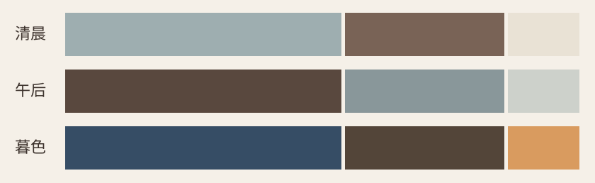

# 贵州肇兴侗寨新人旅拍色彩剧本 ·《一把布伞》

**假设创作简报**。一对新人在秋日走过贵州肇兴侗寨。新娘每到台阶前都会先把裙摆提起一点，新郎留意到这个习惯，到最后一段自然地停下来等她。三场都从两人的日常动作取景。下文的天气、屋檐、朝向和灯位均为创作条件，实际机位待勘景确认。

**人物与造型**。两人从一前一后到并肩同行。新娘为暖中性浅棕肤色，低发髻，象牙白真丝裙、单层白头纱、小银圈耳饰。新郎肤色较深，暖棕底调，短黑发，穿靛青棉外套、米白衬衫、炭灰长裤。深茶色布伞贯穿全段。村寨生活由木墙、石阶、雨声带入，人物穿自己的婚礼衣装。

## 总配色

主选[01 是枝裕和《海街日记》](../references/daylight.md#look-01)。清晨和午后用自然散射光照脸，冷色给远处的天与石路，木褐留给近处的建筑与伞。清晨的亮点在头纱，午后转到檐滴。暮色段借[28 罗杰·迪金斯《光之帝国》](../references/destination.md#look-28)里室内暖光与室外暮色的关系，把暖点缩到檐灯能照亮的半步。新人走入这束光，观众才看清他们已并肩。

| 场次 | 主色与载体 | 辅色与载体 | 点缀色与载体 |
| --- | --- | --- | --- |
| 清晨 | 雾蓝灰 `#9EAEB0` · 天与远路 | 旧木褐 `#796356` · 木屋 | 纱白 `#E9E2D5` · 向光的头纱 |
| 午后 | 湿木褐 `#59483E` · 檐柱 | 石青灰 `#89979A` · 雨街 | 雾银 `#CDD1CB` · 银圈与檐滴 |
| 暮色 | 暮蓝 `#364D65` · 天与石路倒影 | 深茶褐 `#534539` · 布伞和木檐 | 琥珀 `#D99B5F` · 檐灯与局部反光 |

这些 HEX 是构思时的 sRGB 色样。拍到现场后，以两人的肤色、衣物原色和每段的实际入射光校对。

## 三场色彩剧本

五维描述的是交付画面的目标。表中颜色是取样方向，肤色与白纱另行保护。

| 场次与情绪 | 主色 | 饱和度 | 反差 | 黑位 | 高光 |
| --- | --- | --- | --- | --- | --- |
| ① 清晨 · 各自留心脚下 | 雾蓝灰，旧木褐托住人物 | 环境低饱和，脸颊保留血色 | 低反差，天空来光在面颊上有方向 | 略抬，深色门洞还能看见门框 | 薄雾与白纱分出两层，纱边柔亮 |
| ② 午后 · 在檐下一起等雨 | 湿木深褐，檐外透入冷灰 | 木色中低饱和，靛青外套可辨 | 中等，明亮街口衬出檐下轮廓 | 比清晨深，外套暗部仍见棉布褶 | 水滴与小银圈有短促亮点，白纱有褶纹 |
| ③ 蓝调时刻 · 放慢一步等她 | 暮蓝为底，一小块琥珀暖光落在脸侧 | 暮蓝适中，暖色集中在两人身上 | 局部明暗分明，两张脸仍有柔和过渡 | 三场最深，深茶伞面与肩线分开 | 灯光中心可明亮，脸侧和裙摆保留层次 |

**实物色与呈现色**。造型组以中性光下的衣物为准。象牙白裙身在清晨背光处会略偏冷，在暮色灯下只暖向光那一面，单层白纱透出的背景色可再多一点。靛青外套进檐下会接近深藏蓝，肩部仍应辨出蓝色。银圈随天空反出冷白，入灯后只让朝灯的一侧有暖点。木墙本色是褐色，淋雨后更深，面向天空的湿处才映蓝灰。这四种材料也用作三场匹配的参照。

### ① 清晨，伞还没有撑开

**场面**。木屋旁一段平缓石路，开阔天空从画面左侧照入。新娘在左、新郎在右，同向走。快到石阶时她提裙，他的脚步已经向前，眼神刚刚回转。遇到晨雨就转入有天光的连檐下，用檐口远处的雨幕代替雾，保持收伞和行进方向。

**图片提示词**

> 横幅 16:9，写实电影静帧。贵州肇兴侗寨秋日清晨，木屋旁的石路，一左一右的新人沿路向画面右方走。左边新娘暖中性浅棕肤色、低发髻，穿象牙白真丝裙，戴单层白头纱和小银圈耳饰，正低头用左手提起裙摆。右边新郎暖棕肤色较深、短黑发，靛青棉外套、米白衬衫、炭灰长裤，右手垂提收拢的深茶布伞，比她领先半步，刚侧眼看她。用 35 毫米视角从两人前侧拍中远景，脚下第一道石阶入画。左侧开阔天光勾出薄纱，雾蓝灰、旧木褐，低饱和低反差，门洞暗处略抬。保留双颊血色、肤色深浅差与丝裙纹理，银圈只有细小冷白反光。

**视频提示词**

> 生成一条 6 秒、16:9 的写实旅拍长镜头。贵州肇兴侗寨，秋日清晨，木屋、薄雾、石路。新娘在左，暖中性浅棕肤色、低发髻、象牙白真丝裙、单层白头纱、小银圈耳饰。新郎在右，较深暖棕肤色、短黑发、靛青棉外套、米白衬衫、炭灰长裤，右手拿收拢的深茶布伞。35 毫米视角，摄影机从前侧平稳后退，留出两人向画面右方移动的空间。前 3 秒新郎领先半步，伞尖随步幅轻摆。后 3 秒新娘左手提裙迈上一级石阶，他回眼并放慢脚步。结束画面停在她的脚落稳、两人肩线将要齐平的中远景。左侧漫射天光，雾蓝灰和木褐低饱和，暗处柔软，脸颊有血色，白纱在木墙前清晰可见。

### ② 午后，檐口落下一阵雨

**场面**。新人避进开口朝街的木廊下。新娘先站定，松开提裙的左手。新郎把收拢的伞从身侧移到面前，伸左手去解伞扣。以开口处的天光照脸，保留靠木墙一侧的阴影。雨势太大就在更深的屋檐取景，从干燥处拍檐滴，仍让天空的反光进入眼睛。

**图片提示词**

> 横幅 16:9，写实电影静帧，贵州肇兴侗寨午后阵雨。木廊下近距离双人半身像，50 毫米视角，镜头与眼睛平齐。左侧新娘暖中性浅棕肤色、低发髻、象牙白真丝裙、单层白头纱、小银圈耳饰，侧头看着两人之间的伞扣。右侧新郎肤色较深呈暖棕、短黑发、靛青棉外套、米白衬衫、炭灰长裤，右手握收拢的深茶布伞，左手拇指正挑开扣带。人物在前，虚化雨街在后，画面左前方的街口天光照亮眼睛，湿木褐与街外冷灰构成中等反差。深藏蓝肩褶、肤色深浅、银圈上小块天光、白纱重叠处的织纹均可辨。镜头只抓住解扣的片刻。

**视频提示词**

> 生成一条 5 秒、16:9 的写实旅拍长镜头，贵州肇兴侗寨，午后木廊避雨。左侧新娘暖中性浅棕肤色、低发髻、象牙白真丝裙、单层白头纱、小银圈耳饰。右侧新郎较深暖棕肤色、短黑发、靛青棉外套、米白衬衫、炭灰长裤，右手拿收拢的深茶布伞。50 毫米视角从腰部以上的双人中景极慢推近。最初两人靠檐停住，新娘左手放下裙边，望向雨街。新郎把伞竖到两人中间，左手解开扣带，她听见动静低眼看。结束画面是松开的扣带垂下、伞面仍收着，二人的视线落在同一点。檐外的冷天光从左前方入眼，木墙一侧较暗，湿木深褐、低饱和靛青、中等反差。棉布暗纹、白纱和颊部血色自然可辨。

### ③ 傍晚，举伞的人在石阶前停下

**场面**。傍晚小雨，跟两人出檐。新郎用右手举伞，到台阶前先停，新娘提裙跨过来，两人再并肩走。选择有暖灯照到檐边、背景仍有天空亮度的位置。大雨时改在有顶廊道的尽头完成停步，伞沿探出檐口，让雨水和暖灯同框。

**图片提示词**

> 横幅 16:9，贵州肇兴侗寨暮色细雨中的写实电影静帧。木屋檐口的暖灯落在两个人向光的脸侧，远处石路映着暮蓝天色。左侧新娘暖中性浅棕肤色、低发髻、象牙白真丝裙、单层白头纱、小银圈耳饰，左手轻提裙摆，刚跨完一级石阶。右侧新郎较深暖棕肤色、短黑发，靛青棉外套、米白衬衫、炭灰长裤，右手举着已经撑开的深茶布伞，伞向她偏一点。他在阶旁等她，两人目光相遇、肩线齐平。35 毫米视角前侧全身双人构图，让伞沿、脸和落稳的裙摆同时入画。暮蓝中留一小块琥珀色，黑位较深，伞缘和肩线仍然可分，肤色自然有深浅，白纱暖边透出蓝色环境，耳饰只闪一个小暖点。

**视频提示词**

> 生成一条 7 秒、16:9 的贵州肇兴侗寨蓝调时刻写实旅拍长镜头。小雨中的木屋和石阶，左侧新娘暖中性浅棕肤色、低发髻、象牙白真丝裙、单层白头纱、小银圈耳饰。右侧新郎肤色较深呈暖棕、短黑发、靛青棉外套、米白衬衫、炭灰长裤，右手举一把撑开的深茶布伞。35 毫米视角，全身双人景别。摄影机前侧缓慢横移，头两秒两人向右出檐，新郎在一级石阶前停下，把伞稍稍偏向新娘。接下来的三秒她左手提裙跨过台阶，抬眼时两人已经并肩。末两秒摄影机停稳，让他们从暖灯旁一起走入暮蓝。结束画面留下伞缘的暖亮线和两人同一步幅的侧背影。背景暮蓝，光池琥珀色，阴影浓而可辨，灯在肤色和白纱上的冷暖过渡自然，雨声和鞋底落地声很轻。

## 现场与后期交接

- **摄影与灯光**。每次换场，先在两人的站位、同一入射光下拍灰卡，再让两人同框，带上白纱、银圈与靛青衣肩。清晨看纱边，午后看暗侧眼窝，暮色看两张脸走出灯光后是否仍能分辨。拍下每次换位后的参考帧。
- **服装与场记**。三场核对发髻、耳圈、左右站位、提裙的手和持伞的手。伞的状态依次是扣紧、松扣、撑开，开启动作由时间跳切衔接。湿度从略潮、檐外成雨到路面积水逐场增加。
- **调色与剪辑**。先用每场参考帧匹配两人各自的肤色与白纱细节，再建立清晨、午后、暮色逐步加深的环境黑位。把她在阶上落脚、扣带垂下、他先停步的三个停顿点顺次剪在一起看。保留动作的呼吸，让最后一次等待回应清晨的半步距离。
